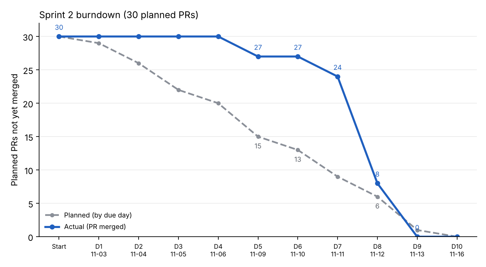

# Sprint 2 – Velocity and Burndown

**Task:** S2-SM-04 · **Sprint:** 2 (Weeks 3–4) · **Facilitator:** Scrum Master

Data: `velocity-data.csv`. Chart: `burndown.png`. Unit: **one task = one planned PR** (the task plan counts tasks this way). "Planned day" is the working day each task is due in the task plan. Merge dates come from the repository history.

> Working days are Monday to Friday: D1 Tue 2026-11-03 to D10 Mon 2026-11-16 (assumed; see `sprint-2-planning-and-board.md`). Work merged on the weekend (Sat 2026-11-07) is counted on the next working day, D5. S2-DEV-07, S2-DEV-08 and the five S2-SM tasks are counted as merged on D9 (Fri 2026-11-13); correct this if they merge on another day.

## 1. Velocity

| Sprint | Planned PRs | Done (merged) | Velocity | Notes |
|---|---|---|---|---|
| 1 | 30 | 30 | 30 | 28 merged by the check; the two Scrum Master documents merged at close |
| 2 | 30 | 30 | 30 | 22 merged by D8, 8 on D9 (one working day before the planned end) |
| Average (S1–S2) | 30 | 30 | **30** | |

Velocity is steady at 30 PRs per sprint, so the next sprint can commit to about 30 PRs again.

### By role (Sprint 2)

| Role | Planned | Merged | On time or early | Average days late |
|---|---|---|---|---|
| Developer | 8 | 8 | 1 | 2.9 |
| DB Admin | 6 | 6 | 1 | 2.0 |
| Tester | 6 | 6 | 3 | 1.2 |
| UI/UX Designer | 5 | 5 | 2 | 1.0 |
| Scrum Master | 5 | 5 | 1 | 3.6 |

**8 of 30 tasks were on time or early** (27%). On average a task merged **2.2 working days after its planned day**; the latest was 8 days late (S2-SM-01, the planning notes). The Designer's PRs were closest to plan.

## 2. Burndown

Remaining = planned PRs not yet merged at the end of the day. "Planned" removes each task on its due day; "Actual" removes it when its PR merged.

| End of | Planned remaining | Actual remaining | Gap |
|---|---|---|---|
| Start | 30 | 30 | +0 |
| D1 Tue 11-03 | 29 | 30 | +1 |
| D2 Wed 11-04 | 26 | 30 | +4 |
| D3 Thu 11-05 | 22 | 30 | +8 |
| D4 Fri 11-06 | 20 | 30 | +10 |
| D5 Mon 11-09 | 15 | 27 | +12 |
| D6 Tue 11-10 | 13 | 27 | +14 |
| D7 Wed 11-11 | 9 | 24 | +15 |
| D8 Thu 11-12 | 6 | 8 | +2 |
| D9 Fri 11-13 | 1 | 0 | -1 |
| D10 Mon 11-16 | 0 | 0 | +0 |

### Reading the chart

- **D1 to D6: flat line at 27 to 30.** The Designer's three PRs merged on the weekend before D5; nothing else merged until D7.
- **D7: first drop.** DB Admin merged migrations 007 to 009 (three PRs).
- **D8: steep drop (16 PRs).** DB Admin finished (DBA-04 to 06), the Developer merged DEV-01 to DEV-05, the Tester merged all six test files and the Designer merged UIX-04 and UIX-05.
- **D9: the last PRs.** DEV-06 to DEV-08 and the five Scrum Master documents.
- The gap against the plan was widest at **D6: 27 remaining against 13 planned**.
- The goal was met and the sprint finished before D10, but the line is a cliff, not a slope. Little review or test time was left after the last features merged.

## 3. Forecast and recommendation for Sprint 3 (Human Resources)

| Item | Value |
|---|---|
| Commitment | 30 PRs (average velocity) |
| Heaviest risk | The same pattern again: late merges, and tests recorded against builds that are not yet merged |
| Checkpoints | D3: every role has opened a PR or reported a blocker. D5: at least 40% of the PRs due so far are merged. D8: all Developer PRs merged except the last one. |
| Rule | A role with nothing merged by D5 raises an impediment that day. |
| Sequence | DB Admin merges the migration a story needs before the Developer task starts; the Tester starts each test file the day its screen merges. |

## 4. Task-level data

| Task | Planned | Merged | Days late | PR |
|---|---|---|---|---|
| S2-DEV-01 | D2 11-04 | D8 11-12 | +6 | #60 (delivered together with DEV-02) |
| S2-DEV-02 | D3 11-05 | D8 11-12 | +5 | #60, #63 |
| S2-DEV-03 | D4 11-06 | D8 11-12 | +4 | #72 |
| S2-DEV-04 | D5 11-09 | D8 11-12 | +3 | #73 |
| S2-DEV-05 | D6 11-10 | D8 11-12 | +2 | #74 |
| S2-DEV-06 | D7 11-11 | D9 11-13 | +2 | #75 |
| S2-DEV-07 | D8 11-12 | D9 11-13 | +1 | to be merged (not yet on main when this was written) |
| S2-DEV-08 | D9 11-13 | D9 11-13 | +0 | to be merged (not yet on main when this was written) |
| S2-DBA-01 | D2 11-04 | D7 11-11 | +5 | #55 |
| S2-DBA-02 | D4 11-06 | D7 11-11 | +3 | #56 |
| S2-DBA-03 | D5 11-09 | D7 11-11 | +2 | #57 |
| S2-DBA-04 | D6 11-10 | D8 11-12 | +2 | #58 |
| S2-DBA-05 | D7 11-11 | D8 11-12 | +1 | #59 |
| S2-DBA-06 | D9 11-13 | D8 11-12 | -1 | #61 |
| S2-TST-01 | D3 11-05 | D8 11-12 | +5 | #62 |
| S2-TST-02 | D5 11-09 | D8 11-12 | +3 | #65 |
| S2-TST-03 | D7 11-11 | D8 11-12 | +1 | #68 |
| S2-TST-04 | D8 11-12 | D8 11-12 | +0 | #69 |
| S2-TST-05 | D9 11-13 | D8 11-12 | -1 | #70 |
| S2-TST-06 | D9 11-13 | D8 11-12 | -1 | #71 |
| S2-UIX-01 | D2 11-04 | D5 11-07 | +3 | #51 |
| S2-UIX-02 | D3 11-05 | D5 11-07 | +2 | #52 |
| S2-UIX-03 | D5 11-09 | D5 11-07 | +0 | #53 |
| S2-UIX-04 | D7 11-11 | D8 11-12 | +1 | #64 |
| S2-UIX-05 | D9 11-13 | D8 11-12 | -1 | #66, #67 |
| S2-SM-01 | D1 11-03 | D9 11-13 | +8 | this batch (in review) |
| S2-SM-02 | D3 11-05 | D9 11-13 | +6 | this batch (in review) |
| S2-SM-03 | D5 11-09 | D9 11-13 | +4 | this batch (in review) |
| S2-SM-04 | D8 11-12 | D9 11-13 | +1 | this batch (in review) |
| S2-SM-05 | D10 11-16 | D9 11-13 | -1 | this batch (in review) |
