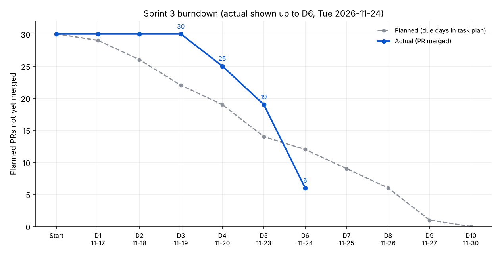

# Sprint 3 – Velocity and Burndown

**Task:** S3-SM-04 (part 1) · **Sprint:** 3 (Weeks 5–6) · **Facilitator:** Scrum Master

Data: `velocity-data.csv`. Chart: `burndown.png`. Unit: **one task = one planned PR**. "Planned day" is the working day each task is due in the task plan. Merge dates come from the repository history (`git log --merges` on `main`).

> **As of the end of D6 (Tue 2026-11-24).** The task is due on D8. Working days are Monday to Friday: D1 Tue 2026-11-17 to D10 Mon 2026-11-30 (assumed; see `sprint-3-planning-and-board.md`). When S3-DBA-06 and the Scrum Master documents merge, add their dates to `velocity-data.csv`, rerun the totals and replace "(to be added)" below. S3-UIX-03 was first merged on D3 (#83) and reverted (#84); the merge that counts is D4. Where one PR holds two tasks (#106: DEV-04 and DEV-05) both get that date.

## 1. Velocity

| Sprint | Planned PRs | Done (merged) | Velocity | Notes |
|---|---|---|---|---|
| 1 | 30 | 30 | 30 | 28 merged by the check; the two Scrum Master documents merged at close |
| 2 | 30 | 30 | 30 | 22 merged by D8, 8 on D9 |
| 3 (as of D6) | 30 | 24 | 24 so far | 6 open: S3-DBA-06 (due D9) and the five Scrum Master tasks |
| Average (S1–S2) | 30 | 30 | **30** | |

If the six open tasks merge by D10, Sprint 3 closes at **30**. Counting only what is merged today, 24 of 30 (80%) was reached on D6, against 12 planned to still be open (18 planned done).

### By role (Sprint 3, as of D6)

| Role | Planned | Merged | On time or early | Late tasks (average days late) |
|---|---|---|---|---|
| Developer | 8 | 8 | 4 | 4 (2.5) |
| DB Admin | 6 | 5 | 2 | 3 (2.3) |
| Tester | 6 | 6 | 5 | 1 (2.0) |
| UI/UX Designer | 5 | 5 | 3 | 2 (1.5) |
| Scrum Master | 5 | 0 | 0 | 5 open |

**14 of 24 merged tasks were on time or early.** The 10 late ones were 1 to 4 working days late (S3-DEV-01 and S3-DBA-01 the latest, +4). Measured against plan alone, the Tester and Designer look early; four of the Tester's six test files merged 2 to 4 days before their due day, but before the screens they test existed (IMP-22), so "early" is not good news there.

## 2. Burndown

Remaining = planned PRs not yet merged at the end of the day. "Planned" removes each task on its due day; "Actual" removes it when its PR merged.

| End of | Planned remaining | Actual remaining | Gap |
|---|---|---|---|
| Start | 30 | 30 | +0 |
| D1 Tue 11-17 | 29 | 30 | +1 |
| D2 Wed 11-18 | 26 | 30 | +4 |
| D3 Thu 11-19 | 22 | 30 | +8 |
| D4 Fri 11-20 | 19 | 25 | +6 |
| D5 Mon 11-23 | 14 | 19 | +5 |
| D6 Tue 11-24 | 12 | 6 | -6 |
| D7 Wed 11-25 | 9 | (to be added) | |
| D8 Thu 11-26 | 6 | (to be added) | |
| D9 Fri 11-27 | 1 | (to be added) | |
| D10 Mon 11-30 | 0 | (to be added) | |

### Reading the chart

- **D1 to D3: flat at 30.** The only PRs were #82 and #83 (UIX-03) on D3, reverted by #84; net zero. The gap against plan grew to +8 at D3, the widest point of the sprint.
- **D4: 5 PRs.** The Designer merged UIX-01 to UIX-05 (UIX-05 is a plan, not a review).
- **D5: 6 PRs.** The Tester merged all six test files and the checklist between 22:01 and 22:19.
- **D6: 13 tasks (12 PRs), 19 down to 6.** DB Admin merged DBA-01 to DBA-05 (migrations 012 to 016) and the Developer merged DEV-01 to DEV-08. The sprint moved from 5 behind plan at D5 to 6 ahead at D6.
- The line again has the **step shape**: nothing from Developer or DB Admin for five days, then everything on one day. It is better than Sprint 2 (27 left at D6, 6 now), but verification time is now short, and the migrations landed after the screens (IMP-23).

## 3. Sprint 4 forecast and recommendation (Sales and Reports)

| Item | Value |
|---|---|
| Commitment | 30 PRs (average velocity, same as the task plan) |
| Heaviest risk | Sprint 4 carries the most code (sales, payments, balances, seven reports, audit viewer). The build must not arrive in one day again. See `sprint-4-risk-register.md`. |
| Checkpoints | D2: DB Admin has merged the migrations the first Developer tasks need. D3: every role has a PR on `main` or a stated blocker. D5: at least 40% of due PRs merged, including at least 2 Developer PRs. D8: all Developer PRs merged except the last. |
| Rules | A migration merges before the Developer task that needs it. The Tester starts each test file the day its screen merges and records commit and date. One task per PR with title `TASK-ID: short description`. |

## 4. Task-level data

| Task | Planned | Merged | Days late | PR |
|---|---|---|---|---|
| S3-DEV-01 | D2 11-18 | D6 11-24 | +4 | #103 |
| S3-DEV-02 | D3 11-19 | D6 11-24 | +3 | #104 (titled "Added joblist") |
| S3-DEV-03 | D4 11-20 | D6 11-24 | +2 | #105 |
| S3-DEV-04 | D5 11-23 | D6 11-24 | +1 | #106 (with DEV-05) |
| S3-DEV-05 | D6 11-24 | D6 11-24 | +0 | #106 (with DEV-04) |
| S3-DEV-06 | D7 11-25 | D6 11-24 | -1 | #108 |
| S3-DEV-07 | D8 11-26 | D6 11-24 | -2 | #114 |
| S3-DEV-08 | D9 11-27 | D6 11-24 | -3 | #115 |
| S3-DBA-01 | D2 11-18 | D6 11-24 | +4 | #109 |
| S3-DBA-02 | D4 11-20 | D6 11-24 | +2 | #110 |
| S3-DBA-03 | D5 11-23 | D6 11-24 | +1 | #111 |
| S3-DBA-04 | D6 11-24 | D6 11-24 | +0 | #112 |
| S3-DBA-05 | D7 11-25 | D6 11-24 | -1 | #113 |
| S3-DBA-06 | D9 11-27 | not yet | open | not yet |
| S3-TST-01 | D3 11-19 | D5 11-23 | +2 | #96 |
| S3-TST-02 | D5 11-23 | D5 11-23 | +0 | #97 |
| S3-TST-03 | D7 11-25 | D5 11-23 | -2 | #98 |
| S3-TST-04 | D8 11-26 | D5 11-23 | -3 | #99 |
| S3-TST-05 | D9 11-27 | D5 11-23 | -4 | #100 |
| S3-TST-06 | D9 11-27 | D5 11-23 | -4 | #101 |
| S3-UIX-01 | D2 11-18 | D4 11-20 | +2 | #85 |
| S3-UIX-02 | D3 11-19 | D4 11-20 | +1 | #86 |
| S3-UIX-03 | D4 11-20 | D4 11-20 | +0 | #87, #88 (first try #83 reverted by #84) |
| S3-UIX-04 | D5 11-23 | D4 11-20 | -1 | #89, #90 |
| S3-UIX-05 | D9 11-27 | D4 11-20 | -5 | #90 (review plan only) |
| S3-SM-01 | D1 11-17 | not yet | open | this batch |
| S3-SM-02 | D3 11-19 | not yet | open | this batch |
| S3-SM-03 | D5 11-23 | not yet | open | this batch |
| S3-SM-04 | D8 11-26 | not yet | open | this batch |
| S3-SM-05 | D10 11-30 | not yet | open | this batch (draft) |
