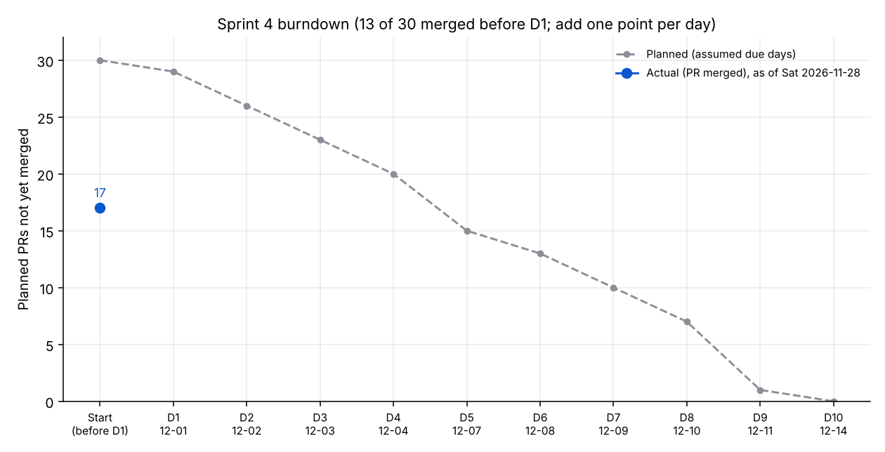

# Sprint 4 – Velocity and Burndown

**Task:** S4-SM-05 (supporting data) · **Sprint:** 4 (Weeks 7–8) · **Facilitator:** Scrum Master

Data: `velocity-data.csv`. Chart: `burndown.png`. Unit: **one task = one planned PR**. Merge dates come from `git log` on `main` (last commit e8a4c2c, 2026-11-27 22:26).

> **As of Sat 2026-11-28, before D1.** Planned days are assumed from the Sprint 3 pattern (D1 = Tue 2026-12-01 to D10 = Mon 2026-12-14; the task plan is not in the repository). The thirteen merged tasks were merged before D1, so they show as negative "days late". On each check day add one row to the burndown table and one point to the chart, and fill the merged date for each task that merged.

## 1. Velocity

| Sprint | Planned PRs | Done (merged) | Velocity | Notes |
|---|---|---|---|---|
| 1 | 30 | 30 | 30 | 28 merged by the check; the two Scrum Master documents merged at close |
| 2 | 30 | 30 | 30 | 22 merged by D8, 8 on D9 |
| 3 | 30 | 30 | 30 | 24 merged on D6; DBA-06 on D7 (#117); the five Scrum Master tasks in #116 on D6 |
| 4 (as of 2026-11-28) | 30 | 13 | 13 so far | 17 open: 6 DB Admin, 6 Tester, 5 Scrum Master |
| Average (S1–S3) | 30 | 30 | **30** | |

If the 17 open tasks merge by D10, Sprint 4 closes at **30** and the project total is **120 PRs** (four sprints of 30).

### By role (Sprint 4, as of 2026-11-28)

| Role | Planned | Merged | Open |
|---|---|---|---|
| Developer | 8 | 8 | 0 |
| DB Admin | 6 | 0 | 6 |
| Tester | 6 | 0 | 6 |
| UI/UX Designer | 5 | 5 | 0 |
| Scrum Master | 5 | 0 | 5 |

## 2. Burndown

Remaining = planned PRs not yet merged at the end of the day.

| End of | Planned remaining (assumed) | Actual remaining | Gap |
|---|---|---|---|
| Start (before D1, 2026-11-28) | 30 | 17 | -13 |
| D1 Tue 12-01 | 29 | ____ | |
| D2 Wed 12-02 | 26 | ____ | |
| D3 Thu 12-03 | 23 | ____ | |
| D4 Fri 12-04 | 20 | ____ | |
| D5 Mon 12-07 | 15 | ____ | |
| D6 Tue 12-08 | 13 | ____ | |
| D7 Wed 12-09 | 10 | ____ | |
| D8 Thu 12-10 | 7 | ____ | |
| D9 Fri 12-11 | 1 | ____ | |
| D10 Mon 12-14 | 0 | ____ | |

### Reading the chart

- The line starts at 17 because the five designs (2026-11-23 and 2026-11-24) and the eight Developer tasks (2026-11-27, 22:00 to 22:26) merged before D1.
- It is the **step shape** for the fourth time: eight Developer tasks in 26 minutes. The remaining 17 tasks are the ones that make the build safe to show: migrations, data, tests, the release checklist and the report.
- A line that stays at 17 through D5 would mean the DB Admin and Tester are blocked; the D3 checkpoint exists to hear that early.

## 3. Task-level data

See `velocity-data.csv` (30 rows: id, role, planned day and date, merged day and date, days late, PR). PR numbers for the Developer tasks: DEV-01 #120, DEV-02 #121, DEV-03 #122, DEV-04 #123, DEV-05 #124, DEV-06 #125 (also holds the first DEV-07 and its revert), DEV-07 #126, DEV-08 #127.
